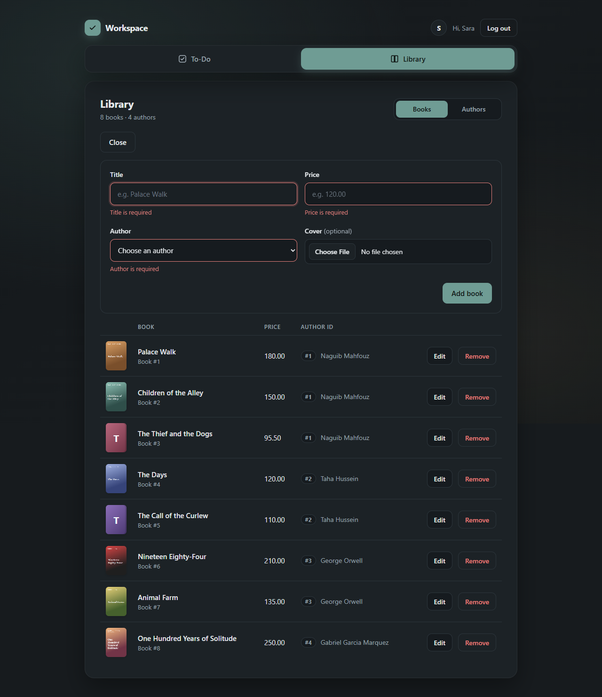

# Lab 4: Search Queries in SQL

Introduction to Database Systems, Alexandria National University, Faculty of Engineering, Fall 2026.

This repository is **Part II, Problem 2** of Lab 4: the LIBRARY database grows to six tables (authors, publishers, categories, books, members, loans), and our website from Lab 2 and Lab 3 gets a new **Explore** tab with the search pages F2.1 to F2.6.

## 1. Team

| Name | ID |
|------|----|
| Adham Ayman | 2204145 |
| Yasser Mohamed | 2204157 |

## 2. Files

```
lab4-2204145-2204157/
  problem2_DDL.sql        creates the database library (6 tables, primary keys, foreign keys, ON DELETE CASCADE)
  problem2_DML.sql        seed data: 5 authors, 3 publishers, 4 categories, 12 books, 6 members, 16 loans
  problem2_Queries.sql    the SQL of every new page, with a "-- F2.x" comment before each query
  website/                our website (Lab 2 + Lab 3) with the new Explore tab
    app.py                the server: routes, validation, the F2.x queries, the prepared statement (bonus)
    database/schema.sql   the Lab 2 database registration (users, todos) used for the login
    templates/            Jinja pages (explore.html is the new one)
    static/               style.css and the JavaScript files
    requirements.txt      Python packages
    .env.example          fake settings; copy it to .env
  screenshots/            pictures of the Lab 3 pages
  README.md
```

## 3. Technology

| Part | What we used |
|------|--------------|
| Database | MySQL 8, run with the MySQL client (`mysql`) or MySQL Workbench |
| Back end | Python 3, Flask, PyMySQL (plain SQL with parameters, no ORM), mysql-connector-python (the prepared statement of F2.1), bcrypt, python-dotenv |
| Front end | HTML (Jinja templates), our own CSS (no framework), JavaScript (no library) |

## 4. How to run it (from an empty machine)

You need **Python 3.10+** and **MySQL 8** with its client `mysql` (it comes with MySQL Server, in `C:\Program Files\MySQL\MySQL Server 8.0\bin` on Windows).

1. **Get the code**
   ```
   git clone https://github.com/Adhamayman22/lab4-2204145-2204157.git
   cd lab4-2204145-2204157
   ```

2. **Build the databases.** In a terminal opened in `lab4-2204145-2204157`, run the scripts with the MySQL client. Each one asks for your MySQL password.
   ```
   mysql -u root -p < problem2_DDL.sql
   mysql -u root -p < problem2_DML.sql
   mysql -u root -p < website/database/schema.sql
   ```
   - The `<` works in **Command Prompt (cmd)**, Git Bash, macOS and Linux. In **PowerShell** write it like this instead: `Get-Content problem2_DDL.sql | mysql -u root -p`
   - Or open each file in MySQL Workbench (`File > Open SQL Script`) and press the lightning button.
   - `problem2_DDL.sql` starts with `DROP DATABASE IF EXISTS library`, so it can be run again and again (it replaces the Lab 3 `library` database). Run it before `problem2_DML.sql`.
   - `website/database/schema.sql` creates `registration` (the login, from Lab 2). Skip it if you already have that database.

3. **Try the queries** (optional): `mysql -u root -p < problem2_Queries.sql` prints the result of every page.

4. **Install the Python packages** (Windows):
   ```
   cd website
   python -m venv venv
   venv\Scripts\activate
   pip install -r requirements.txt
   ```
   On macOS / Linux: `source venv/bin/activate` instead of the second line. If PowerShell refuses `activate`, skip it and use `venv\Scripts\python.exe` instead of `python` below.

5. **Create your `.env` file** (still inside `website`):
   ```
   copy .env.example .env          (Windows)
   cp .env.example .env            (macOS / Linux)
   ```
   Open `.env` and set `DB_USER` and `DB_PASSWORD` to your MySQL user and password, and `SECRET_KEY` to any long random text. Leave `DB_NAME=registration` and `LIBRARY_DB_NAME=library` as they are.

6. **Start the server**
   ```
   python app.py
   ```

7. **Open** <http://localhost:5000>, press *Create one*, register, and you land on the app. The **Explore** tab at the top has the Lab 4 pages.

## 5. The LIBRARY database

```
AUTHOR    (author_id, name, country)
PUBLISHER (publisher_id, name, country)
CATEGORY  (category_id, name)
BOOK      (book_id, title, price, publish_year, author_id, publisher_id, category_id)
MEMBER    (member_id, name, email, join_date)
LOAN      (loan_id, book_id, member_id, loan_date, return_date)
```

- Every `..._id` primary key is `INT AUTO_INCREMENT`; `price` is `DECIMAL(10,2)` with `CHECK (price >= 0)`; `publish_year` is `SMALLINT`; dates are `DATE`; text is `VARCHAR`. `member.email` and `category.name` are `UNIQUE`.
- Foreign keys: `book.author_id`, `book.publisher_id` and `book.category_id` refer to `author`, `publisher` and `category`; `loan.book_id` refers to `book` and `loan.member_id` to `member`.
- **`ON DELETE CASCADE`**: deleting an author deletes their books, and deleting a book deletes its loans (so deleting an author also removes the loans of their books).
- `return_date` is `NULL` while the book is still borrowed; `CHECK (return_date IS NULL OR return_date >= loan_date)`.
- The parents (author, publisher, category, member) are created before `book` and `loan`, because a table can only point at a table that already exists. The DML inserts the rows in the same order.
- Kept from Lab 3 (bonus): `author.photo` and `book.cover`, the file name of an uploaded image.

### What the seed data contains

| The lab asks for | In our data |
|---|---|
| at least 4 authors, 3 publishers, 3 categories, 10 books, 5 members, 12 loans | 5, 3, 4, 12, 6, 16 |
| two authors from the same country | Naguib Mahfouz and Taha Hussein (Egypt) |
| an author with no books | Chinua Achebe |
| an author who wrote at least 2 books | Mahfouz (4), Garcia Marquez (3), Orwell (3), Hussein (2) |
| an author and a publisher from the same country | Mahfouz / Hussein and Dar El Shorouk (Egypt); Orwell and Penguin Books (United Kingdom) |
| a book priced between 15 and 20 | Animal Farm 15.00, Children of the Alley 16.00, Down and Out in Paris and London 17.25, Palace Walk 18.50, Sugar Street 19.99 |
| a book that was never borrowed | Chronicle of a Death Foretold, Down and Out in Paris and London |
| a member with no loans | Nour Hassan |
| a loan that is not returned yet | loans 4, 7, 13, 14 and 16 |

## 6. The website: the new pages

After logging in, the bar at the top has three tabs: **To-Do** (Lab 2), **Library** (Lab 3) and **Explore** (Lab 4). Explore has a small menu with one page per requirement. Every page shows its result and has a **Show the SQL** button with the exact query it ran. The same queries are in [problem2_Queries.sql](problem2_Queries.sql).

| # | Page | SQL | What it shows |
|---|------|-----|---------------|
| F2.1 | Search | `WHERE ... LIKE`, `BETWEEN`, `ORDER BY price` | A form with a title keyword, a minimum and a maximum price and a category list. The matching books, cheapest first. Every field is optional; the form is checked on the server (`Enter a valid price, like 15 or 19.99`, `The maximum must be at least the minimum`, `Choose an existing category`). |
| F2.2 | Catalogue | 3 × `JOIN` | Every book with the author, publisher and category **names** instead of the ids. |
| F2.3 | Reports | `GROUP BY`, `HAVING`, `COUNT/AVG/SUM/MIN/MAX` | (a) books and average price per category, (b) authors with at least 2 books, (c) total, smallest and largest price of the library. |
| F2.4 | Loans | `JOIN`, `LEFT JOIN ... IS NULL` | (a) loans not returned yet with the book title and member name, (b) members who never borrowed, (c) books never borrowed. |
| F2.5 | Most borrowed | `GROUP BY`, `ORDER BY ... DESC`, `LIMIT` | The 3 books with the most loans (ranked) and the member with the most loans. |
| F2.6 | Authors | `LEFT JOIN` + `COUNT(b.book_id)`, `JOIN` | (a) every author with their number of books, 0 included, (b) books whose author and publisher come from the same country. |

### Bonus: a prepared statement in F2.1

The search does not build its SQL from what the user typed. The query has `?` placeholders:

```sql
WHERE b.title LIKE ? AND b.price BETWEEN ? AND ? AND (? = 0 OR b.category_id = ?)
```

`run_prepared()` in `app.py` uses `mysql-connector-python` with `cursor(prepared=True)`: the SQL text is sent to MySQL first (it is **prepared**), then the values are sent separately in the binary protocol. A keyword like `x' OR 1=1--` is only ever a value, so it simply finds no book. The `%` and `_` the user types are escaped too, so they match those characters and are not used as wildcards. `problem2_Queries.sql` shows the same thing in plain SQL with `PREPARE ... FROM '...?...'` and `EXECUTE ... USING @variables`.

### Changes to the Lab 3 pages

The book form (add and edit) now also asks for the **publish year**, the **publisher** and the **category** (lists of the existing rows), with the same messages in JavaScript and on the server: `Year is required`, `Enter a valid year, like 1956`, `Year must be between 1000 and <this year>`, `Publisher is required`, `Category is required`, `Choose an existing publisher`, `Choose an existing category`. Removing a book or an author now also removes their loans (`ON DELETE CASCADE`).

Everything else from Lab 2 and Lab 3 still works the same: register / login with bcrypt, private to-do lists, add / edit / remove books and authors with optional images, light and dark mode, and phone layout.

## 7. Screenshots (Lab 3 pages)

| To-Do tab | Library: books |
|---|---|
|  |  |

| Library: authors | Add a book: the messages |
|---|---|
|  |  |
