# Lab 3: Foreign Keys and Simple SQL

Introduction to Database Systems, Alexandria National University, Faculty of Engineering, Fall 2026.

- **Problem 1**: the COMPANY database (DDL, DML, and the answers to Q1.1 to Q1.3).
- **Problem 2**: the LIBRARY database (authors and books), added to our Lab 2 website.

## 1. Team

| Name | ID |
|------|----|
| Yasser Mohamed | 2204157 |
| Adham Ayman | 2204145 |

We worked on this lab together, on the same computer, so all the commits in this repository come from a single GitHub account.

## 2. Files

```
lab3-2204157-2204145/
  problem1_DDL.sql        Problem 1: creates the database company (3 tables, primary and foreign keys)
  problem1_DML.sql        Problem 1: rows for every table (6 employees, 3 departments, 4 projects)
  problem1_Answers.txt    Problem 1: the SQL for Q1.1 to Q1.3 and the real MySQL output / errors
  problem2_DDL.sql        Problem 2: creates the database library (author, book)
  problem2_DML.sql        Problem 2: seed data (4 authors, 8 books)
  website/                our Lab 2 website with the new Library pages
    app.py                the server: routes, validation, bcrypt, SQL with parameters
    database/schema.sql   the Lab 2 database registration (users, todos) for the login
    templates/            Jinja pages
    static/               style.css and the JavaScript files
    requirements.txt      Python packages
    .env.example          fake settings; copy it to .env
  screenshots/            pictures used in this README
  README.md
```

## 3. Technology

| Part | What we used |
|------|--------------|
| Database | MySQL 8, run with the MySQL client (`mysql`) or MySQL Workbench |
| Back end | Python 3, Flask, PyMySQL (plain SQL with `%s` parameters, no ORM), bcrypt, python-dotenv |
| Front end | HTML (Jinja templates), our own CSS (no framework), JavaScript (no library) |

## 4. How to run it (from an empty machine)

You need **Python 3.10+** and **MySQL 8** with its client `mysql` (it comes with MySQL Server, in `C:\Program Files\MySQL\MySQL Server 8.0\bin` on Windows).

1. **Get the code**
   ```
   git clone <repository-url> lab3-2204157-2204145
   cd lab3-2204157-2204145
   ```

2. **Build the databases.** In a terminal opened in `lab3-2204157-2204145`, run the scripts with the MySQL client. Each one asks for your MySQL password.
   ```
   mysql -u root -p < problem1_DDL.sql
   mysql -u root -p < problem1_DML.sql
   mysql -u root -p < problem2_DDL.sql
   mysql -u root -p < problem2_DML.sql
   mysql -u root -p < website/database/schema.sql
   ```
   - The `<` works in **Command Prompt (cmd)**, Git Bash, macOS and Linux. In **PowerShell** write it like this instead: `Get-Content problem2_DDL.sql | mysql -u root -p`
   - Or open each file in MySQL Workbench (`File > Open SQL Script`) and press the lightning button.
   - Every DDL script starts with `DROP DATABASE IF EXISTS`, so the scripts can be run again and again. Run a DDL script before its DML script.
   - Problem 1 (`company`) is not used by the website. The website needs `library` (Problem 2) and `registration` (the login, from Lab 2).

3. **Install the Python packages** (Windows):
   ```
   cd website
   python -m venv venv
   venv\Scripts\activate
   pip install -r requirements.txt
   ```
   On macOS / Linux: `source venv/bin/activate` instead of the second line. If PowerShell refuses `activate`, skip it and use `venv\Scripts\python.exe` instead of `python` below.

4. **Create your `.env` file** (still inside `website`):
   ```
   copy .env.example .env          (Windows)
   cp .env.example .env            (macOS / Linux)
   ```
   Open `.env` and set `DB_USER` and `DB_PASSWORD` to your MySQL user and password, and `SECRET_KEY` to any long random text. Leave `DB_NAME=registration` and `LIBRARY_DB_NAME=library` as they are.

5. **Start the server**
   ```
   python app.py
   ```

6. **Open** <http://localhost:5000>, press *Create one*, register, and you land on the app. Use the **Library** tab at the top to reach the books and the authors.

## 5. Problem 1: the COMPANY database

```
EMPLOYEE   (ssn, fname, lname, bdate, address, gender, salary, Dno)
DEPARTMENT (Dnumber, Dname, mgr_ssn, mgr_start_date)
PROJECT    (Pnumber, Pname, Plocation, Dno)
```

- Types: `CHAR(9)` for the ssn, `VARCHAR` for names and places, `DATE` for dates, `CHAR(1)` for the gender, `DECIMAL(10,2)` for the salary, `INT` for the numbers.
- Foreign keys: `employee.Dno` and `project.Dno` refer to `department.Dnumber`; `department.mgr_ssn` refers to `employee.ssn`.
- EMPLOYEE and DEPARTMENT point at each other. A table can only point at a table that already exists, so EMPLOYEE is created first and its foreign key is added at the end with `ALTER TABLE ... ADD FOREIGN KEY`.
- The DML inserts the employees with `Dno = NULL`, then the departments (their managers now exist), then sets every `Dno` with `UPDATE`, then inserts the projects.

The answers are in [problem1_Answers.txt](problem1_Answers.txt), with the SQL and the exact output of MySQL:

| Question | Short answer |
|----------|--------------|
| Q1.1 Delete an employee that a department references | Refused, `ERROR 1451 Cannot delete or update a parent row`. The row stays; delete or change the department first. |
| Q1.2 Project for a department that does not exist | Refused, `ERROR 1452 Cannot add or update a child row`. No row is added (referential integrity). |
| Q1.3 First row when `mgr_ssn` and `Dno` are both `NOT NULL` | Every order fails (1452, 1048). Insert the first employee and department before the foreign key that closes the cycle exists and add it later with `ALTER TABLE`, or use `SET FOREIGN_KEY_CHECKS = 0` for those two rows. |

## 6. Problem 2: the LIBRARY database

```
AUTHOR (author_id, name, country)
BOOK   (book_id, title, price, author_id)
```

- `author_id` and `book_id` are `INT AUTO_INCREMENT` primary keys; `price` is `DECIMAL(10,2)`; text is `VARCHAR`.
- `book.author_id` is `NOT NULL` and refers to `author.author_id` with **`ON DELETE CASCADE`**: deleting an author deletes all their books in the same statement.
- Bonus columns: `author.photo` and `book.cover` hold the file name of an uploaded image (`NULL` when there is none).
- Seed data: 4 authors and 8 books, with fixed ids so the data is the same on every machine.

## 7. The website

After logging in, a bar at the top has two tabs: **To-Do** (Lab 2) and **Library** (Lab 3). Pressing a tab changes what is shown in place: the coloured pill slides to the new tab and the new page slides in from its side, without reloading the page and without scrolling. The address changes too (`/todos`, `/library`, `/library?view=authors`), so Refresh and the Back button work. Inside Library, a smaller switch moves between **Books** and **Authors** the same way. Without JavaScript the tabs are plain links and everything still works.

### Lab 3 pages

| # | Requirement | How |
|---|-------------|-----|
| F2.1 | Show a table of the books (with the author_id of each book) and a table of the authors | Library tab, Books / Authors. Each book shows its `author_id` (and the author's name, matched in Python, no JOIN). Each author shows how many books they have. |
| F2.2 | Add a book and add an author | "+ Add a book" / "+ Add an author" open a form above the table. A book's author is chosen from a list of the existing authors. |
| F2.3 | Edit a book and edit an author | "Edit" opens a form filled with the current values (`/books/<id>/edit`, `/authors/<id>/edit`). |
| F2.4 | Remove a book | "Remove" asks "are you sure?" first. |
| F2.5 | Remove an author | "Remove" warns how many books will be removed with them; `ON DELETE CASCADE` deletes those books. |
| Bonus | Images | Optional cover for a book and photo for an author, with a preview before uploading; they can be replaced or removed. Without one, a coloured placeholder with the initials is shown. |

The SQL is simple `SELECT`, `INSERT`, `UPDATE` and `DELETE`, always with `%s` parameters.

### Checks (browser and server, same messages)

| Form | Messages |
|------|----------|
| Book | `Title is required`, `Title is too long (200 characters at most)`, `Price is required`, `Price cannot be negative`, `Enter a valid price, like 120 or 99.50`, `Price is too large (99999999.99 at most)`, `Author is required`, `Choose an existing author` |
| Author | `Name is required`, `Name is too long (100 characters at most)`, `Country is required`, `Country is too long (50 characters at most)` |
| Image | `Choose a PNG, JPG, GIF or WEBP image` (checked from the file's bytes, not its name), `The image is too large (2 MB at most)` |

When the server finds an error it shows the same form again with the messages and the values that were typed, and the database is not touched. If an author is removed while someone adds a book for them, MySQL refuses the insert (error 1452) and the form shows `Choose an existing author`.

### From Lab 2 (still the same)

| # | Requirement |
|---|-------------|
| R1 | Register with name, e-mail, password, confirm password; a duplicate e-mail shows `Email Already Exists`; after registering the user is logged in. |
| R2 | Login; a wrong e-mail and a wrong password show the same `Invalid email or password`; Log out ends the session. |
| R3 | Every page after login is private (a visitor is sent to the login page). Each user sees only their own to-dos, newest first. |
| R4 to R7 | Add, edit, mark done / not done, delete a to-do (with "are you sure?"). |
| R8 | The same checks in JavaScript and on the server, with the exact messages of the lab. |
| R9 | bcrypt hashes (cost 12); SQL always with parameters; `user_id` always from the session (`AND user_id = %s`). |
| R10 | One consistent style, works at 360 px wide, clear messages, empty states. |
| Extra | Light / dark mode button (sun / moon) in the top bar, and in the corner of the login and register pages. The choice is remembered in the browser; with no choice the site follows the system setting. |
| Lab 2 bonus | Filters (All / Open / Done), a search box and a counter of open to-dos. |

The library is shared by all logged-in users (the `book` and `author` tables have no `user_id`), while the to-do list stays private to each user.

## 8. Screenshots

| To-Do tab | Library: books (with covers) |
|---|---|
| 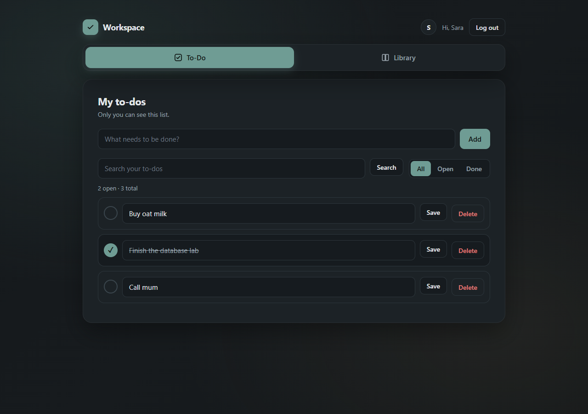 | 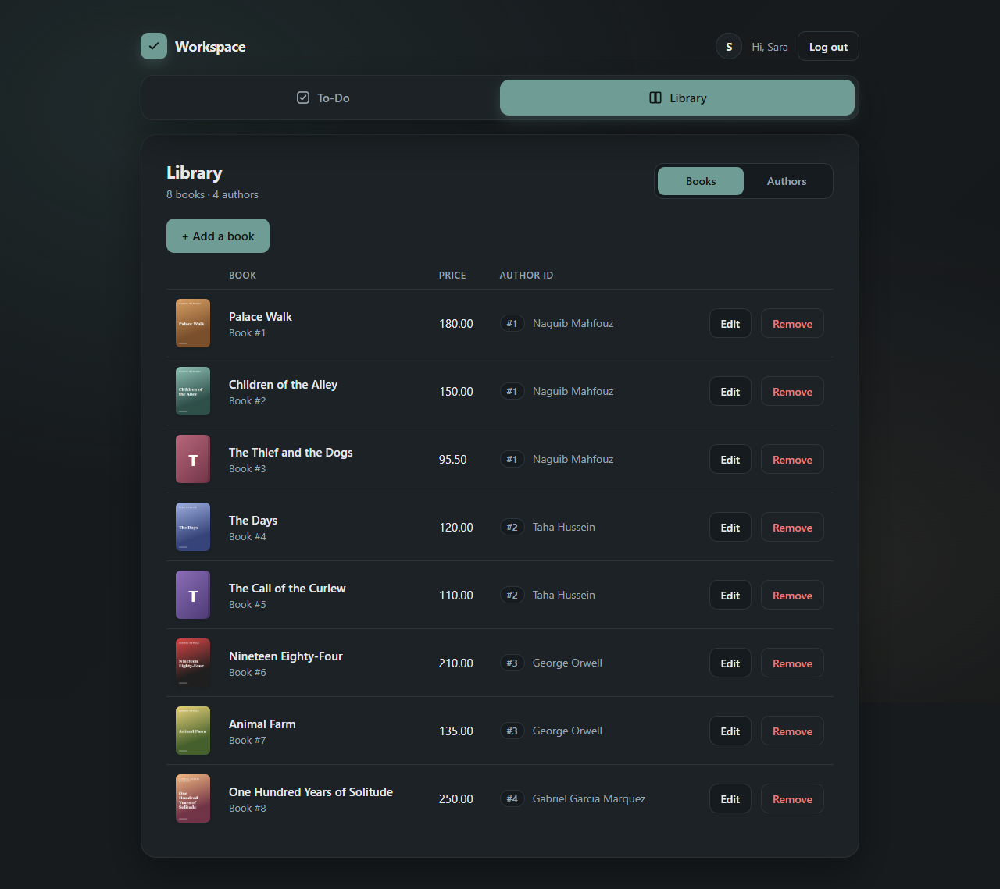 |

| Library: authors (with photos) | Add a book: the messages |
|---|---|
| 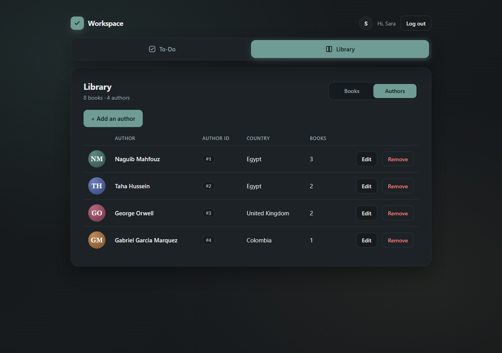 |  |

| Edit a book | The pill sliding between the tabs |
|---|---|
| 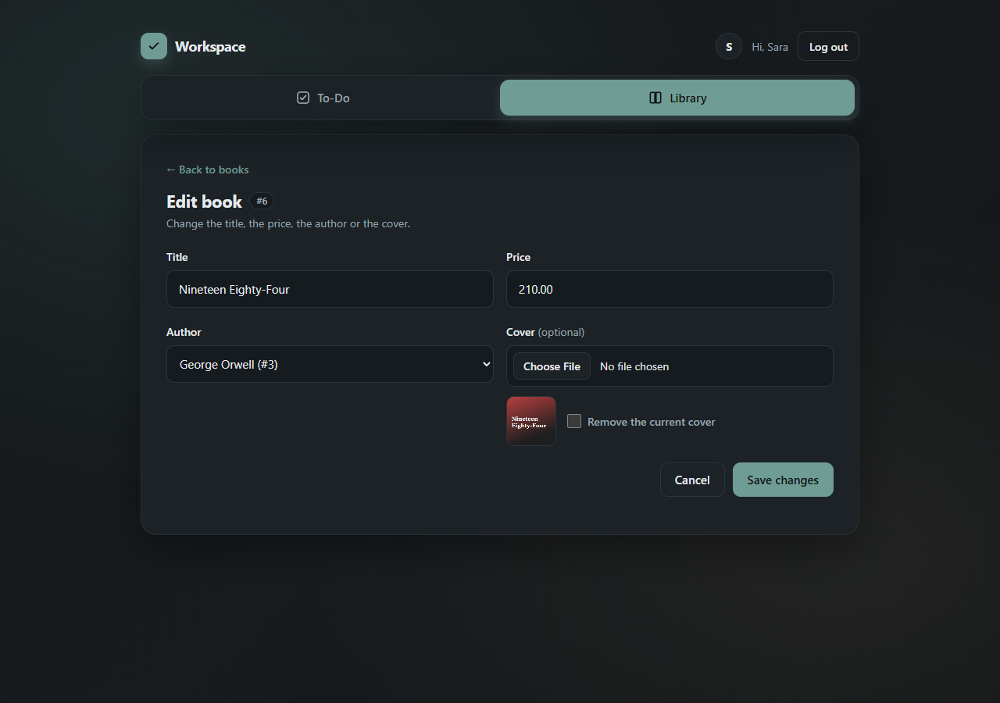 | 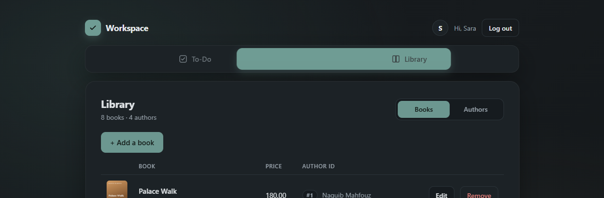 |

| Phone: books | Phone: authors | Phone: to-dos |
|---|---|---|
| 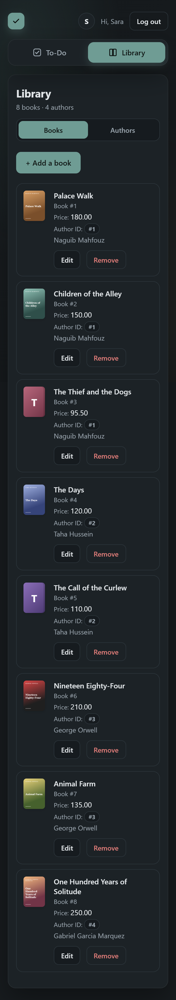 | 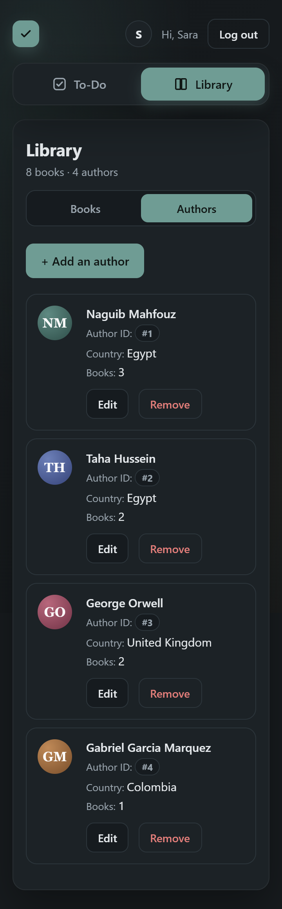 | 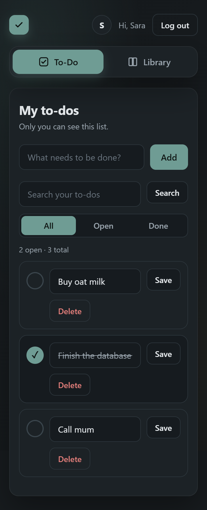 |

| Light mode | Register with errors | Login |
|---|---|---|
| 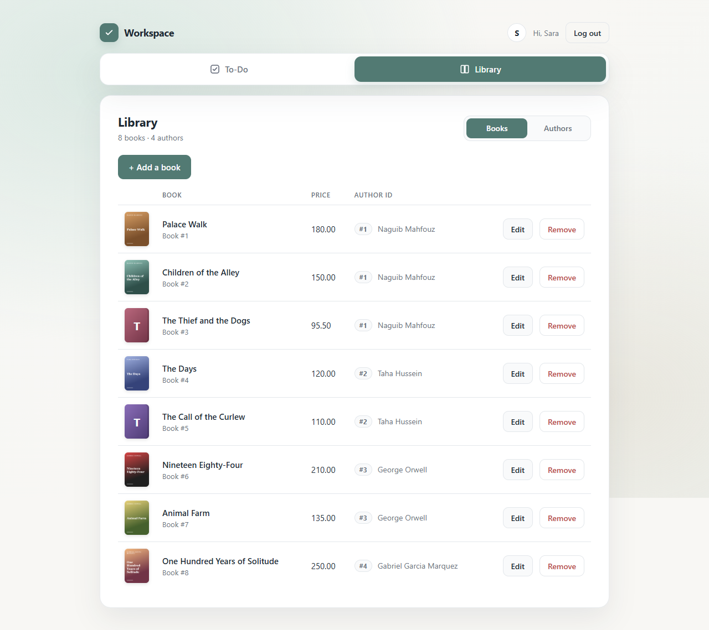 | 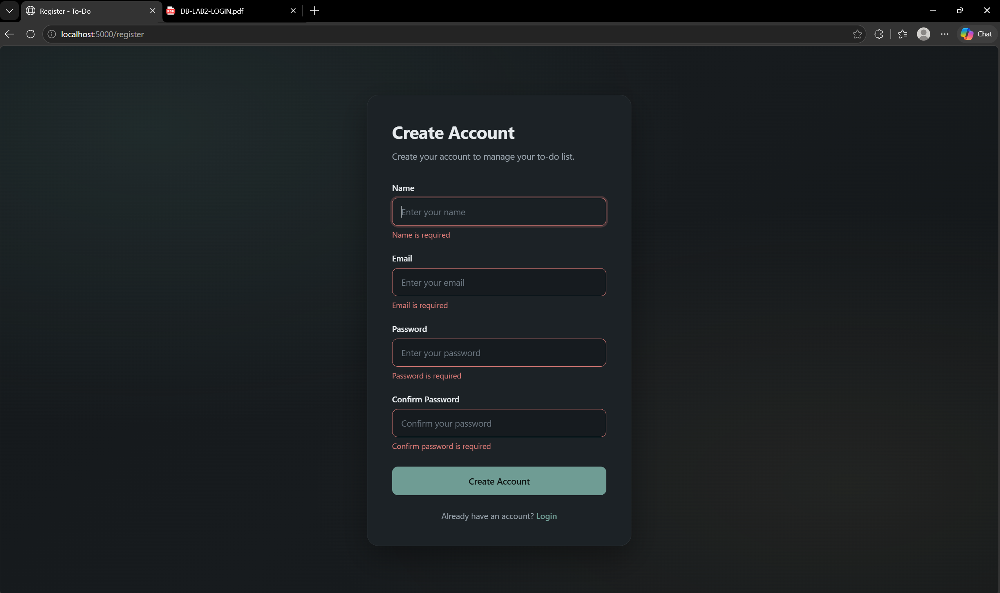 | 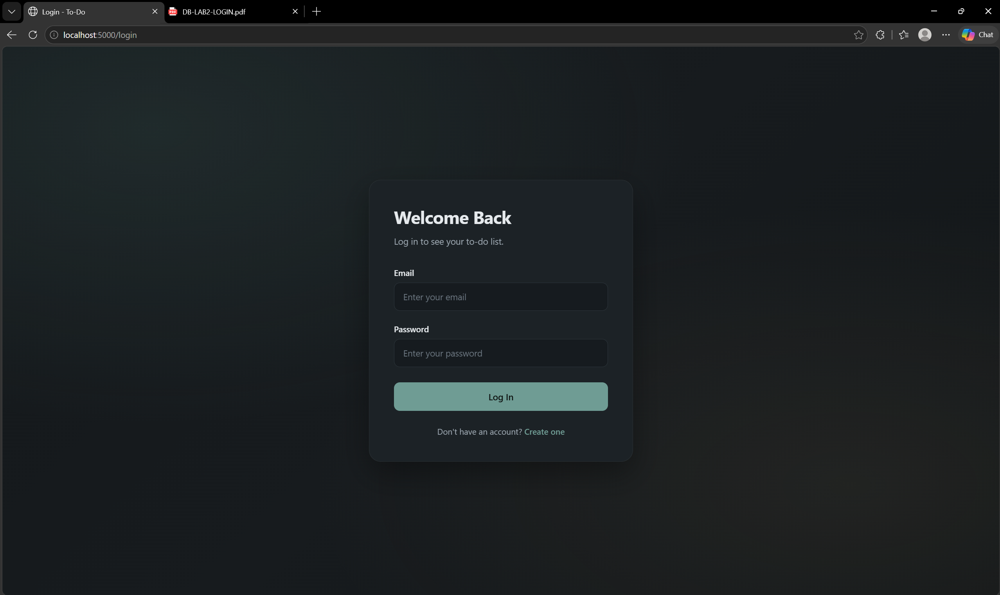 |

## 9. Lab 2 answers

**(a) Why do `UPDATE` and `DELETE` contain `AND user_id = ?`, and what changes if you remove it?**

The id of a to-do comes from the browser, so anybody can send a request with somebody else's number. With `AND user_id = ?` (the id of the logged-in user, taken from the session) the statement only matches rows that belong to the current user; for a to-do that is not theirs it changes zero rows. If we remove it, any logged-in user could edit, mark or delete the to-dos of every other user just by changing the number in the request.

**(b) What happens if you insert a to-do for a `user_id` that does not exist, and which constraint of the lecture is that?**

MySQL refuses the `INSERT` with error 1452 (a foreign key constraint fails) and no row is added. This is the **referential integrity** constraint: every value of the foreign key `todos.user_id` must be a primary-key value that exists in `users`.

**(c) Why do you store a hash and not the password?**

If the database is ever leaked, the passwords must not be readable. A hash cannot be turned back into the password. bcrypt is salted (two equal passwords give two different hashes) and slow on purpose (guessing many passwords is expensive). To log in, the library compares the typed password with the stored hash.

**(d) The `name` column is `NOT NULL`: why did you still need your own check for an empty name?**

`NOT NULL` only refuses `NULL`. An empty text `''` (or a name made of spaces) is a value, so MySQL accepts it. Only our own checks, in JavaScript and again on the server, can refuse it and show `Name is required`.
